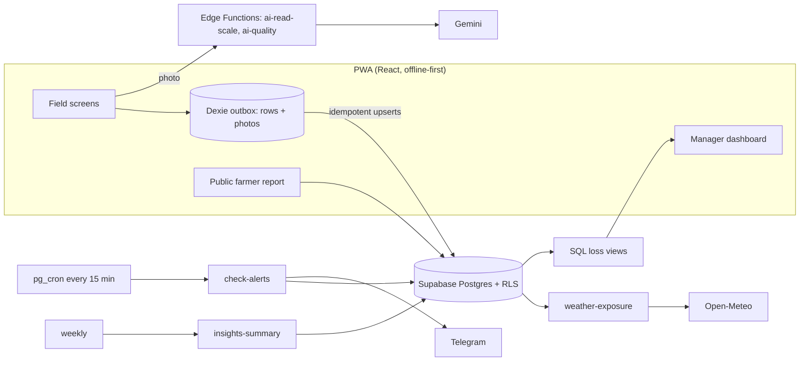
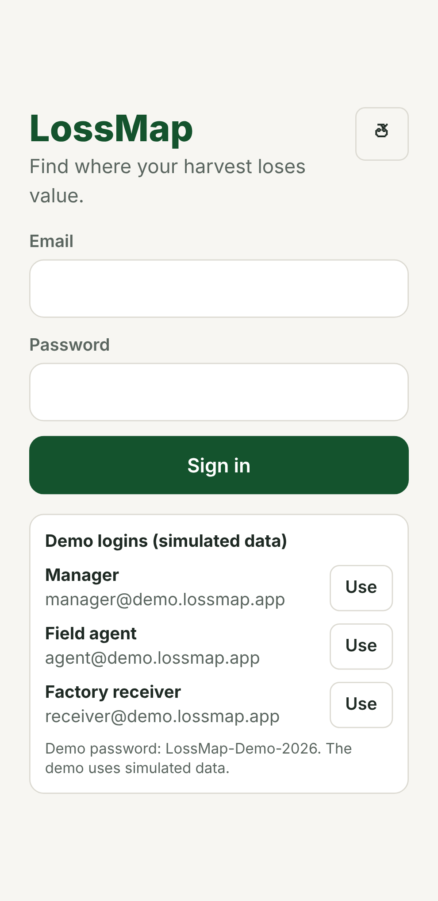
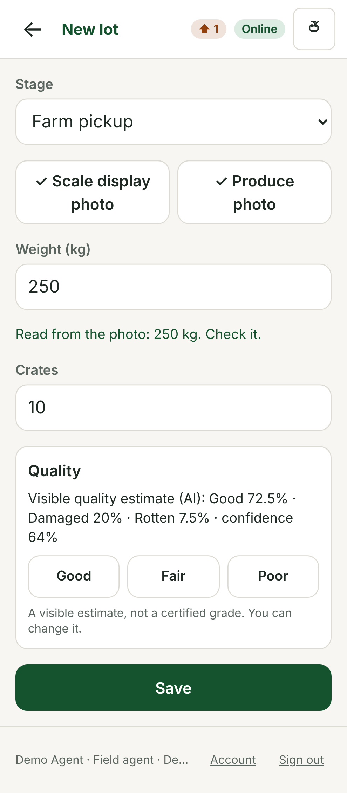
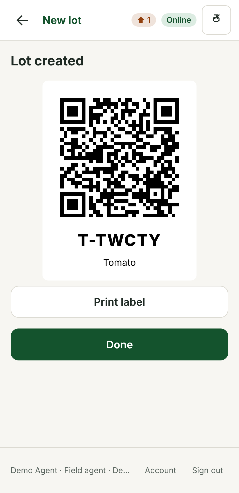
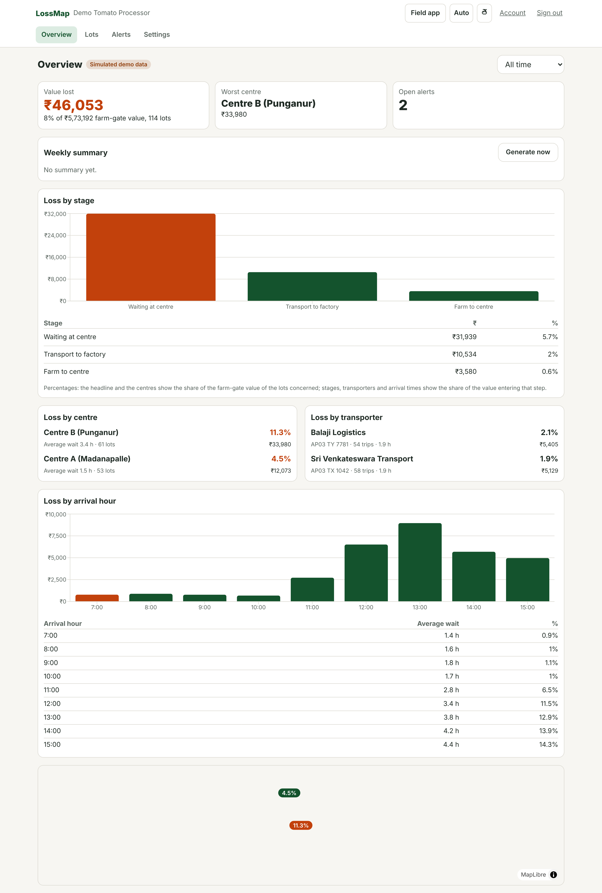
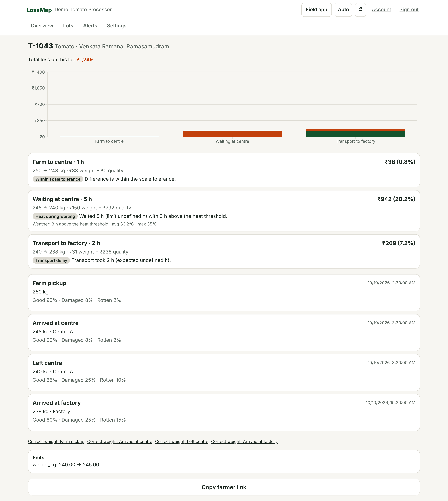
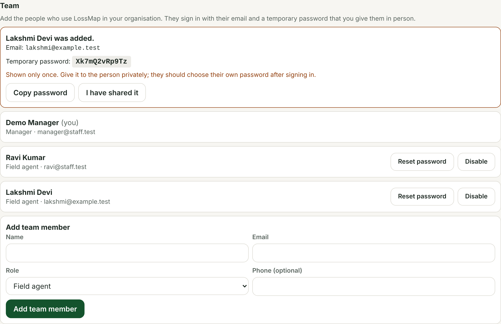

# LossMap: find where your harvest loses value

**HackAP Agritech Innovation Challenge 2026, Track 3 (Post-Harvest), Problem 02: tracking losses in the first leg of the chain.**

Small lots travel from scattered farms through collection centres to a processor. The chain records the final weight, not *where* quality and value were lost. LossMap turns the weighing that already happens at each checkpoint into the answer to **where, when and why value was lost, in rupees**, and warns the manager before produce spoils.

> **Status (23 Oct 2026):** the code is complete and tested locally. **Nothing has been deployed or connected to live Supabase, Gemini, Telegram or Vercel**, and nothing has been tried on a real phone. The demo organisation holds **simulated** data. AI accuracy has not been measured and no accuracy is claimed. See [docs/PROGRESS.md](docs/PROGRESS.md).

## What it does
1. **Capture in seconds, offline.** At each checkpoint (farm pickup, centre arrival, centre dispatch, factory arrival, optional storage) staff scan the lot QR and photograph the **scale display** and the **produce**. GPS and time are automatic. Everything is saved on the phone first and uploads when there is signal.
2. **AI reads the scale and estimates visible quality** (Gemini). The worker always confirms or edits. If AI fails or is offline the app falls back to typing. Quality is labelled *"Visible quality estimate (AI)"*, never a certified grade.
3. **Heat exposure is added automatically** per segment from Open-Meteo hourly temperatures (never invented: "unavailable" is shown when missing).
4. **Loss waterfall per lot, in ₹**: weight loss and quality loss per stage, with a probable cause from transparent rules (heat during waiting, waited too long, transport delay, handling damage). The rule and its numbers are shown.
5. **Live alerts**: "Lot T-1043 has waited 3.4 h at 35°C at Centre B. Dispatch now." on the dashboard and Telegram, retried until delivered.
6. **Manager dashboard** (managers only): ₹ lost by stage, centre, transporter and arrival hour, map, alerts, weekly summary (English and Telugu), every bar drills down to segments, lots, photos.
7. **Farmer lot report**: a public read-only link per lot with the farm-gate weight, quality estimate and photo.
8. **Team and accounts**: managers add staff (a temporary password is shown once), reset passwords, disable people (access stops immediately); everyone can change their own password. No public sign-up; real customers are created with `scripts/create-org.mjs`.

## Demo data (simulated)
A tomato processor near Madanapalle, three villages, two collection centres, 14 days, 114 lots, generated deterministically (`packages/core/src/demo`). Measured through the real SQL views (before real weather is attached):

| | |
|---|---|
| Value lost | ₹46,053 of ₹5,73,192 farm-gate value (**8.0%**) |
| By stage | waiting at the centre ₹31,939 (5.7% of the value entering it), transport ₹10,534 (2.0%), farm to centre ₹3,580 (0.6%) |
| By centre | Centre B **11.3%** (avg wait 3.4 h) vs Centre A **4.5%** (1.5 h): about 2.5 times |
| By arrival hour | 07:00 to 10:00 about 1%; 12:00 to 15:00 11.5% to 14.3% |

These are properties of generated data, not results from a real customer.

Demo logins (the login page offers them): `manager@demo.lossmap.app`, `agent@demo.lossmap.app`, `receiver@demo.lossmap.app`, password `LossMap-Demo-2026`. Live URL: *to be filled in after deployment.*

## Run it
```bash
npm ci
cp .env.example web/.env      # fill VITE_SUPABASE_URL / VITE_SUPABASE_ANON_KEY
npm run dev                   # http://localhost:5173
```
Connecting Supabase, Gemini, Telegram and hosting is configuration only: [docs/GO_LIVE_CHECKLIST.md](docs/GO_LIVE_CHECKLIST.md).

| Command | What it does |
|---|---|
| `npm run lint` / `typecheck` | ESLint, TypeScript |
| `npm test` | 42 core + 11 web unit tests |
| `npm run db:test` | Applies all migrations to a clean local Postgres 16; 38 SQL assertions (row-level security, loss-view parity with hand-calculated numbers, the demo story) and 34 assertions that run the real Edge Function code (team management, demo seed, weather, alert sweep) against that schema |
| `npm run e2e` | 39 browser tests (Chromium, 360 px phone and desktop, real service worker offline, WCAG 2.1 A/AA checks); `SHOTS=1` also regenerates the screenshots |
| `npm run deno:check` / `sync:functions` / `check:functions` | Type-check Edge Functions; vendor `packages/core` into them; verify no drift |
| `node scripts/smoke.mjs` | End-to-end check against a **live** project (never run yet) |
| `node scripts/create-org.mjs` | Create a real (non-demo) organisation and its first manager |
| `node scripts/seed-demo.mjs` | Load or reset the demo from your machine |

## Architecture

| Layer | Choice |
|---|---|
| Frontend | React 19, TypeScript, Vite, Tailwind 4, `vite-plugin-pwa`, react-i18next (EN/TE), Dexie, Recharts, MapLibre + OpenFreeMap |
| Backend | Supabase free tier: Postgres, Auth, Storage, Edge Functions (Deno), RLS, pg_cron |
| AI | Gemini via AI Studio key; model names only in environment variables |
| Weather / alerts | Open-Meteo forecast API with `past_days` and a day cache / Telegram Bot API |

More: [docs/TECHNICAL_APPROACH.md](docs/TECHNICAL_APPROACH.md), [docs/DECISIONS.md](docs/DECISIONS.md), [docs/DEMO_SCRIPT.md](docs/DEMO_SCRIPT.md), [docs/JURY_QA.md](docs/JURY_QA.md), [docs/PITCH_CONTENT.md](docs/PITCH_CONTENT.md), [docs/pitch/](docs/pitch).

## Screenshots
Real UI on a mocked backend; loss figures are the real views' output over the simulated scenario.

| Field app (phone) | | |
|---|---|---|
|  |  |  |





More in [docs/screenshots](docs/screenshots).

## Limitations (honest list)
- **Not connected to any live service yet**; `scripts/smoke.mjs` has never run. No real-phone testing.
- **AI accuracy is not measured.** The AI reading, its confidence and the confirmed value are stored side by side so it can be measured. Quality is a visible estimate; internal defects cannot be seen.
- Free tiers: Open-Meteo's free tier is non-commercial; free-tier Gemini may use inputs to improve Google products, so real customer data needs the paid tier; Supabase free projects pause when idle (keep-alive job).
- Two scales can disagree: a tolerance band treats small differences as noise and a weight gain is shown as "variance", never negative loss. Cause tags are indications, not proof.
- A determined colluding insider can still photograph a false number; flags and the audit trail make that visible, not impossible.
- Thresholds (heat, safe wait) are configurable per crop and need calibration with real customers. Prices and the business model are proposals to validate.
- The demo password is public; the daily keep-alive resets the three demo logins.
- Competitor comparisons in the pitch material come from public positioning and must be verified before presenting.
